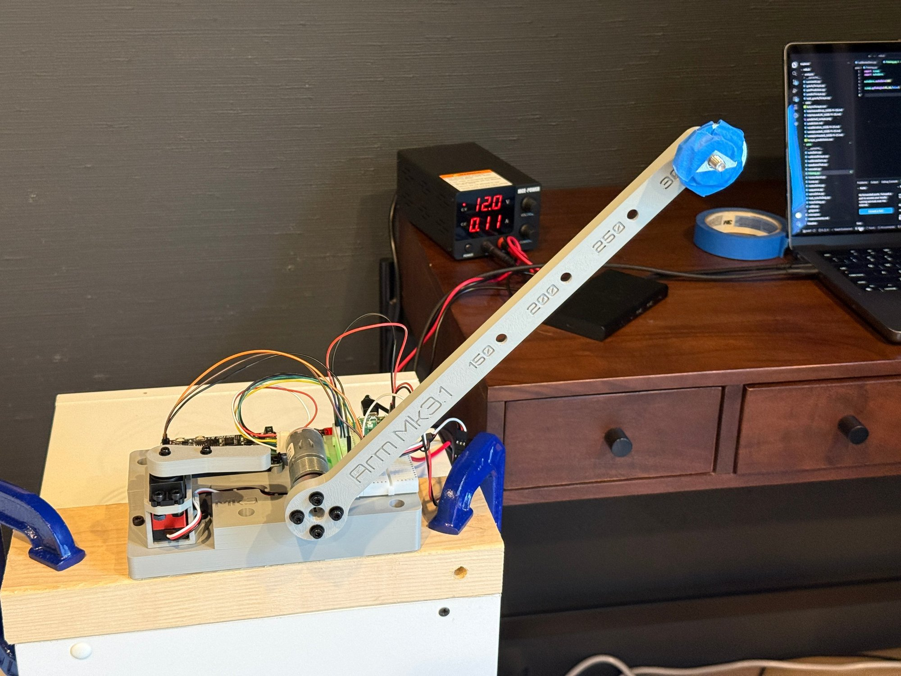
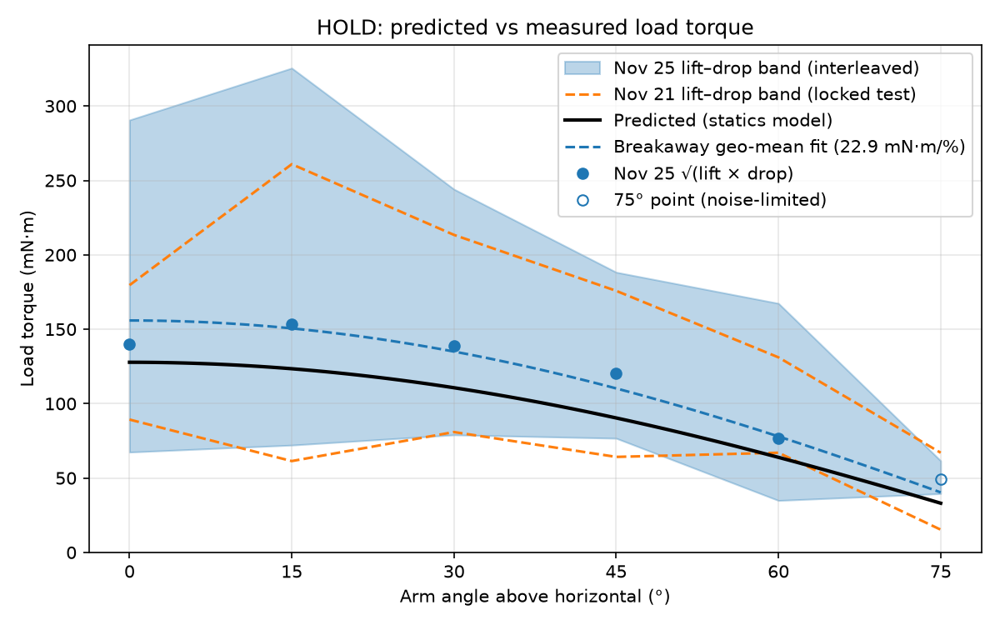
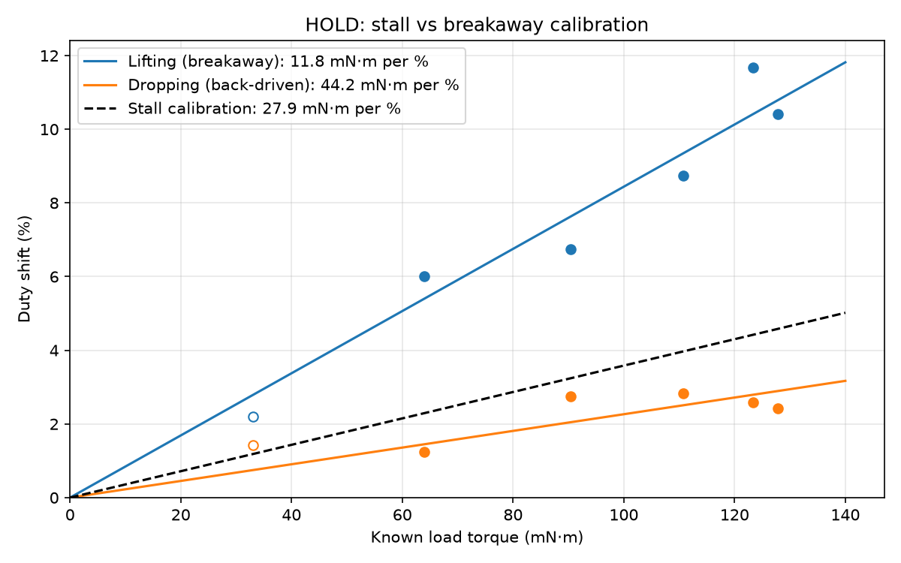

A single-joint torque test rig: predict, lock, measure, explain

<nav class="toc" markdown="1">

## Contents
{: .toc-heading}

- [Why this exists](#why), and why I wrote every line of firmware this time
- [The rig](#rig), four arms, two zero pins, and a current sensor I gave up on
- [Software](#software), the encoder, the PI loop, auto-zero, and the threshold search
- [The prediction and the lock](#lock)
- [The miss](#miss), 41 to 164% high against a promised 20%
- [Why it missed](#why-it-missed), gearbox losses, and the test that checked them
- [What broke along the way](#what-broke)
- [What I'd do differently](#what-id-do-differently)
- [Unresolved](#unresolved)

</nav>

*The rig: a 12 V gearmotor on a printed baseplate, a Raspberry Pi Pico and a Cytron MD10C driver,
and the printed arm with washers on the 300 mm hole.*

HOLD is a single motorized joint built to answer one question: can I predict, from statics, how
much torque it takes to hold a known load at a given angle, and then measure it? I wrote the
prediction down and committed it to the repo before taking any sweep data, so I couldn't adjust it
afterwards. The measurement missed the prediction by a factor of about two. Working out why turned
out to be the most useful part of the project: the gearbox loses about half the torque passing
through it at breakaway, which reads high when the motor lifts and low when gravity drives the arm
down. A drop-side test I ran to check that explanation came out the way it predicted, and combining
both sides brought the estimate to within 22% of the model.

  <iframe style="width:100%;aspect-ratio:16/9;border:0;"
    src="https://www.youtube-nocookie.com/embed/zt4yyD-_rmM"
    title="HOLD threshold trial" allowfullscreen
    allow="accelerometer; clipboard-write; encrypted-media; gyroscope; picture-in-picture"></iframe>

*One threshold trial. The duty steps up 0.25% at a time, the arm re-levels between steps, and the
terminal prints the duty at which it finally breaks away and rises 2°.*

| Spec | |
|---|---|
| Motor | JGA25-370 12 V gearmotor, 150 RPM |
| Encoder | Motor side, 1245.5 ticks per output turn (measured; the listing implies 748) |
| Electronics | Raspberry Pi Pico (MicroPython), Cytron MD10C, 20 kHz PWM, bench supply at 12 V and 0.5 A |
| Arm | Printed PLA, 49.03 g, centre of mass 136 mm, load holes every 50 mm from 150 to 300 mm |
| Position loop | PI, about 85 Hz, ±2° hold band |
| Zeroing | Servo-driven pin at +155.9°, repeatable to 2 ticks (0.58°) |
| Test load | 43.44 g at 300 mm, 127.8 mN·m at horizontal |
| Result | Locked prediction missed by 41 to 164%; gearbox-corrected estimate within 22% |

## Why this exists {#why}

On [REACH](../reach/), my last project, I did the mechanical and electrical work, but about 80% of
the control code was written by Claude Code against my spec, and I accepted or rejected it on
instinct. HOLD is the fix for that. The rule was that I write every line of firmware on the Pico
myself, starting from not knowing what a variable was, and I used AI as a tutor and reviewer that
points at bugs without handing me the corrected line. The two plotting scripts for the final
figures are the exception: Gemini generated them from my specification, and I reviewed them.

The project started as "a joint I control myself" and turned into a measured test within the first
day, because a joint that moves proves nothing about whether I understand it. The plan was to
predict the holding torque from statics, measure it, and see how close I got. The constraints were
about five hours a week for three months, no machine shop, a kitchen scale for force measurement,
and Python I was learning as I went.

I skipped a counterweight on purpose. A counterweight cancels the arm's own torque but not the
load's, so instead every measurement runs twice, unloaded and loaded, and the difference is the
load torque. That difference is the number the whole project is built around.

## The rig {#rig}

*The baseplate from above: the MD10C on standoffs, the Pico on a breadboard, the zero-pin servo,
and the power leads tied down to printed anchors.*

The first arm was a hand-cut aluminum bar on a flange coupler, mounted on a 2×4. The coupler's set
screws kept backing out under the reversing torque of the position loop, which had also happened
on REACH and on earlier robotics builds, and blue threadlocker didn't stop it. I replaced the
coupler with a goBILDA clamping hub and built a new arm around it, which made the gearbox backlash
measurable for the first time: about 4° of free play at the arm.

The next change was driven by resolution. One 10.20 g washer at 150 mm shifts the motor's duty by
about half a percent, which is smaller than the scatter between trials, so I printed a 300 mm arm
with load holes every 50 mm. That version flexed visibly under load, so I reprinted it with more
infill. The final arm, Mk3.1, weighs 49.03 g with its centre of mass 136 mm from the shaft. The
whole rig now sits on a printed baseplate screwed to the 2×4, so nothing moves between sessions.

Zeroing went through two versions. The first was a fixed bolt the arm drove into, at about 14° below
level. It worked until the washers on the loaded arm started hitting it. The second is a
retractable pin on a hobby servo, placed at +155.9°, past vertical and outside the arm's working
sweep, so it can't interfere with a test.

*The zero pin is the printed lever on the servo beside the hub. During auto-zero it swings out and
the arm drives into it; for testing it swings back out of the way.*

I originally planned to measure torque from motor current with an INA219 sensor, and I wrote my own
register-level driver for it rather than using a library. It read about 25% high against Ohm's law,
and when I put it in the 12 V line it caused a short I never traced. I took it out and measured
torque against a kitchen scale instead, which was the better reference anyway.

## Software {#software}

**Encoder.** The encoder sits on the motor side of the gearbox. I measured 1245.5 ticks per output
turn over two 10-turn trials (12453 and 12457), 66% more than the seller's specification implies,
so every angle in the project uses the measured number. My first interrupt-driven counter
read 38% high, because each physical edge fired the interrupt several times. The fix was to ignore
calls where the channel hadn't actually changed state. It then read 2.8% low, because MicroPython
queues ordinary interrupts and the second channel was being read late. Switching to hard interrupts
fixed it: 6227 counts over five fast turns, against 6227.5 expected.

**Position loop.** P control alone stopped about 9° short of the target, because a proportional
command shrinks with the error and eventually can't beat friction. Adding an integral term closed
the gap. The final loop runs PI at about 85 Hz, with an integral clamp, anti-windup while the
command is saturated, and a ±2° hold band inside which the command is zero.

**Auto-zero.** On startup the servo extends the pin, the motor drives the arm into it at 30%
until the encoder stops changing, and the code sets the encoder offset so that position reads
+155.9°. The arm then drives to level and the pin retracts. I derived the offset formula myself from
my tick-to-degree function. It's repeatable to 2 ticks (0.58°) over four runs. Its known gap is
that any stall counts as reaching the pin.

  <iframe style="width:100%;aspect-ratio:16/9;border:0;"
    src="https://www.youtube-nocookie.com/embed/5emchgNkEaM"
    title="HOLD auto-zero" allowfullscreen
    allow="accelerometer; clipboard-write; encrypted-media; gyroscope; picture-in-picture"></iframe>

*Auto-zero: the pin extends, the arm drives into it, the encoder is zeroed against the pin's known
angle, and the arm returns to level.*

**Threshold search.** At each angle the script re-levels the arm with the position loop, switches
it off, and steps the motor duty by 0.25% per second until the arm moves 2°. Stepping up finds the
lift threshold, the duty at which the arm breaks away upward. Stepping down finds the drop
threshold, the duty at which it starts to fall. The space between them is the friction band.

## The prediction and the lock {#lock}

The model is plain statics: torque equals mass times g times the centre-of-mass radius times the
cosine of the angle from horizontal. To turn torque into motor duty I calibrated the motor in
stall, with the arm pressing down on a kitchen scale and the duty stepped from 4 to 22%. Between 6
and 18% the fit was linear at 27.9 mN·m per percent of duty (R² = 0.996). As a sanity check, the
model predicted 55.0 mN·m for the arm's own weight and the scale read 54.4.

The locked method was: load torque equals the loaded lift threshold minus the unloaded lift
threshold, times 27.9, at 0, 15, 30, 45, 60 and 75°, compared against 127.8·cos θ mN·m. I committed
it with an expected error of within 20%, or within 10% if the stall calibration held at breakaway.
I had already measured one point at 0° before the commit, and it came in 2.6% above the
prediction. I disclosed that in the lock, and it's part of why I trusted the method.

## The miss {#miss}

*The black curve is the locked prediction. The shaded band runs from the drop shift up to the lift
shift on Nov 25, and the dashed orange lines are the same band from the locked Nov 21 sweep. The
dots combine lift and drop to cancel gearbox losses, and the dashed blue curve is a cosine fitted
to them, 22% above the prediction.*

The full sweep read 41 to 111% high at every angle, against a promise of 20%. Holding to the lock
meant the result stands as measured, and anything after it is reported alongside it, not in its
place.

I went through the obvious suspects first. I recalibrated the motor on the new arm and got 29.0
mN·m per percent, 4% from the original, so the calibration slope couldn't explain a factor of two.
Motor heating didn't fit, because the motor was cold. Drift was the strongest candidate, since the
loaded set had run about an hour before the unloaded one, so I reran everything with unloaded and
loaded trials back to back at each angle. The error got larger, 86 to 164%, so drift wasn't it. I
re-weighed the load as well, and it was within 0.4%.

## Why it missed {#why-it-missed}

A gearbox loses some of the torque passing through it to friction in the gear teeth, and that
friction grows with the load. If the gearbox passes a fraction η of the torque, then lifting a load
takes about load ÷ η from the motor, so the lift method reads high. Letting gravity drive the gears
backwards works the other way: the friction resists the fall, so the motor needs only about
load × η to hold the arm, and a drop measurement should read low.

That was testable, so I tested it. If the explanation was right, the drop shift had to come out
below the prediction, the opposite of the lift. It did, at every angle from 0 to 60°: 15 to 47% low.
Dividing the two shifts gives η², which puts the gearbox efficiency at about 0.46 to 0.64, plausible
for a small multi-stage spur gearbox at breakaway. Multiplying them cancels η entirely, so
√(lift × drop) estimates the true load torque. A cosine fitted to those points comes out at about
155 mN·m against 127.8 predicted, 22% high. The plain average of lift and drop can't do that,
because it always lands above the true value, which is why my secondary method missed too.

*The same data treated as a calibration. With the known gravity torque as the load, lifting takes
11.8 mN·m per percent of duty and dropping 44.2. The stall calibration, 27.9, sits between them.*

The reason the stall calibration didn't catch any of this is that it measured a different friction
state. Pressing on a scale, nothing slides, and static friction only takes up as much force as it
needs, so most of the motor's torque reaches the scale. At breakaway, static friction is at its
limit and works fully against the motion. It's the same gearbox in two different conditions, and I
calibrated in one and measured in the other.

The full error analysis, with the error budget, is
[in the repo](https://github.com/leosrheinheimer/HOLD/blob/main/errorAnalysis.md).

## What broke along the way {#what-broke}

**The encoder lied twice.** Before the interrupt fixes above, turning the disc by hand gave 22, 29
and 36 ticks per turn on three tries, and one output turn read 600° using the seller's numbers. I
stopped trusting anything I hadn't counted at the output shaft over ten turns.

**The short.** The INA219 shorted the 12 V supply when I wired it into the motor line. I ruled out
the driver and the shunt, and I spent about an hour hunting before pulling the sensor out entirely.
That was the right call, and I should have made it sooner.

**Stale code on the board.** More than once, the Pico ran an older uploaded copy of a module rather
than the one in my editor, including test code at the top level of a file that ran on import and
moved the motor. I now sync only modules to the board and keep test code out of them.

**Zeroing timed out mid-travel.** With the new pin past vertical, the arm has to swing about 246°
to reach it, and my original 4-second timeout ended the zeroing halfway there. Raising it to 10
seconds and the drive to 30% fixed it. With the pin left retracted, the arm now spins until the
timeout and reports failure instead of setting a wrong zero.

**The load stayed on.** Twice, I left the washers on the arm during a run that was supposed to be
unloaded. The first time, no threshold was found at all. The second time, six identical readings
at 45° gave it away, and I reran that angle.

## What I'd do differently {#what-id-do-differently}

The biggest lesson is to calibrate in the same condition I measure in. My calibration was taken in
stall and my measurement at breakaway, and the whole factor of two lives in that gap. The next
version would calibrate at breakaway, in both directions, against a known torque.

I'd also lock a method that uses both thresholds. Measuring the lift alone carries the gearbox
losses into the result by design, and I could have seen that before the lock if I'd thought
through what friction does in each direction. Beyond that, I'd measure the gearbox friction
directly, driving and back-driven, to check whether it's the same both ways, and I'd put the
encoder on the output shaft so the 4° of backlash doesn't sit between the measurement and the arm.

Finally, I'd randomise the gear mesh between trials by spinning the arm a random number of full
turns before each one. At a fixed arm angle the output gear always sits in the same place, but the
gears inside the gearbox don't land on the same teeth after a full turn unless every stage ratio is
a whole number. All my trials at one angle ran in a single mesh state, so their spread shows
repeatability in one gear configuration rather than the real scatter, and any friction tied to
particular teeth was baked into every trial at that angle.

## Unresolved {#unresolved}

**The last 22%.** If the gearbox lost the same fraction in both directions, the lift and drop
errors would multiply to exactly one. They multiply to 1.2 to 1.8. Either the gearbox loses more
when it's driven than when it's back-driven, which is common in gear trains, or there's a scale
error I haven't found.

**A bump at 15°.** The arm reads more load torque at 15° than at horizontal on both test days, which
gravity can't do. It's most likely friction that depends on which gear teeth are in mesh. The test
that would settle it is the random spin above: if the bump smears out or moves, it's the gear mesh,
and if it stays at 15°, it's something on the output side. For the measurement I fit the cosine the
physics requires. For controlling this particular rig, a lookup
table of measured thresholds would capture it better.

**Day-to-day variation.** The loaded lift thresholds read about 4 points of duty higher on the
second test day while the unloaded ones matched. I don't know why.

**The INA219.** It read 25% high and shorted the supply, and I never found out why either happened.

---

Built October to November 2026. Raspberry Pi Pico, MicroPython, JGA25-370 gearmotor, Cytron MD10C,
goBILDA 1309 hub, PLA printed on a Bambu A1. Code, data and the full error analysis are at
[github.com/leosrheinheimer/HOLD](https://github.com/leosrheinheimer/HOLD).
