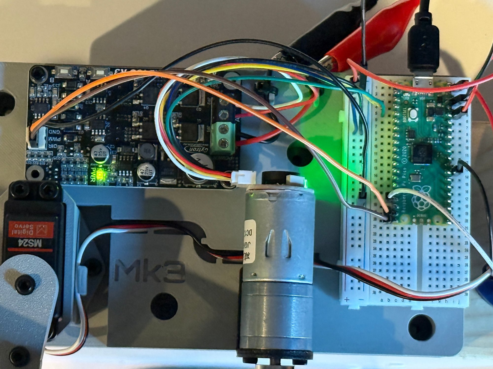
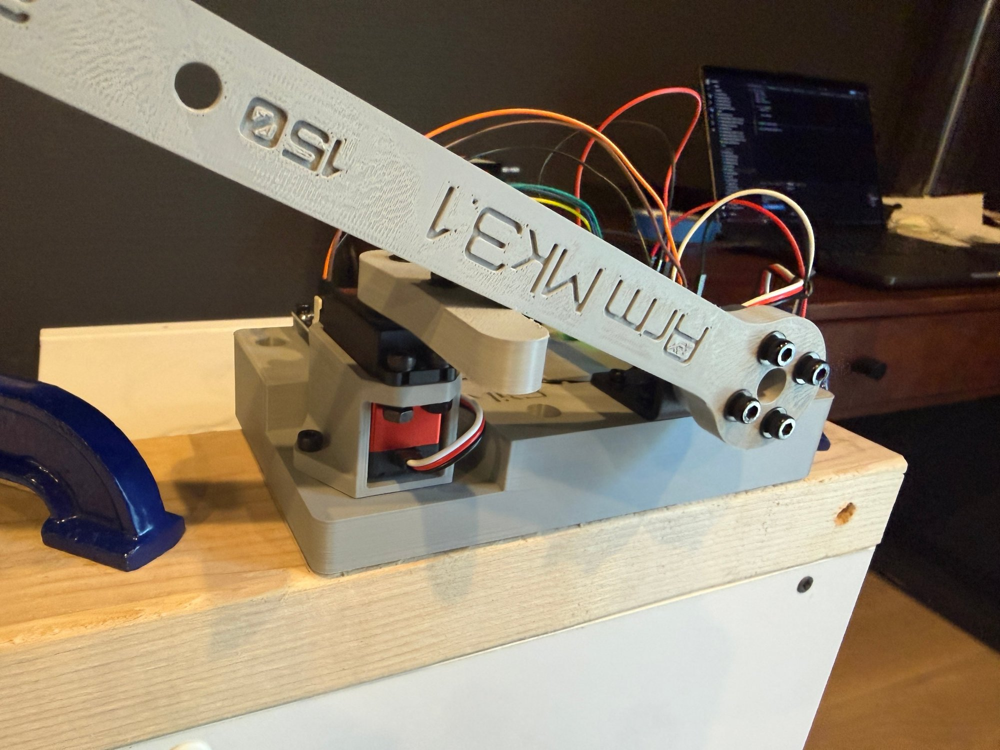

{: .photo}

*The rig, with washers taped on at the 300 mm hole.*

HOLD is one motorized joint with an arm on it. I used it to test whether I could predict, from
statics, how much torque it takes to hold a known load at a given angle. I committed the prediction
to the repo before running the sweep, so I couldn't change it after seeing the data. It was off by
about a factor of two. Most of this page is about finding out why, which came down to gearbox
friction at breakaway.

<nav class="toc" markdown="1">

## Contents
{: .toc-heading}

- [Why I built HOLD](#why)
- [The rig](#rig)
- [Software](#software)
- [The prediction](#prediction)
- [The miss](#miss)
- [Why (I think) it missed](#why-it-missed)
- [What I'd do differently](#what-id-do-differently)

</nav>

  <iframe style="width:100%;aspect-ratio:16/9;border:0;"
    src="https://www.youtube-nocookie.com/embed/zt4yyD-_rmM"
    title="HOLD threshold trial" allowfullscreen
    allow="accelerometer; clipboard-write; encrypted-media; gyroscope; picture-in-picture"></iframe>

*One threshold trial. The motor duty goes down 0.25% at a time until the arm breaks loose and falls.*

| Spec | |
|---|---|
| Motor | JGA25-370 12 V gearmotor (from Amazon), 150 RPM |
| Encoder | Motor side, 1245.5 ticks per output turn (measured) |
| Electronics | Raspberry Pi Pico (MicroPython), Cytron MD10C, bench supply at 12 V |
| Arm | Printed PLA, 49.03 g, load holes every 50 mm from 150 to 300 mm |
| Position loop | PI, about 85 Hz, ±2° hold band |
| Zeroing | Servo-driven pin, repeatable to 0.6° |
| Result | Prediction missed by 41 to 111%; within 22% after correcting for gearbox losses |

## Why I built HOLD {#why}

On [REACH](../reach/), my last project, I did the mechanical and electrical work, and most of the
control code was written by Claude Code from my spec. For HOLD I wrote all of the firmware on the
Raspberry Pi Pico myself, starting with very little knowledge of Python syntax. I used AI to review
my code and point out bugs, not to write it. The two scripts that make the final plots are the
exception: Gemini generated those from my spec.

I wanted a project where I could quantify the result, so I set HOLD up as a test with a number at
the end: predict the holding torque, measure it, and compare.

## The rig {#rig}

{: .photo}

*The baseplate from above: motor driver on the left, Pico on the breadboard, zero-pin servo in the
corner.*

The motor is a 12 V JGA25-370 gearmotor driven by a Cytron MD10C, controlled by a Raspberry Pi Pico
running MicroPython. Everything sits on a printed baseplate screwed to a 2×4, so I could reliably
clamp it down to the testing bench, and holding torque was measured against a kitchen scale.

The arm went through four versions. The first was aluminum on a set-screw coupler, which kept
loosening under the back-and-forth of the position loop (the same thing happened on REACH). A
goBILDA clamping hub fixed that. The current arm is printed, 300 mm long (the limit for my 3D
printer), with load holes every 50 mm. The length is for resolution: a washer further out shifts
the motor duty more, so smaller differences show up above the noise.

To zero the encoder, the arm needs a hard stop at a known angle. The first one was a fixed bolt
drilled into the 2×4. I wanted to learn more servo control, so I replaced it with a printed lever on
a hobby servo that swings out to zero the arm and retracts to clear the arm's path during testing.

{: .photo}

*The zero pin is the printed lever on the servo next to the hub.*

## Software {#software}

All of it runs on the Pico. The encoder counts with hard interrupts, and I measured 1245.5 ticks
per output turn myself because the seller's spec was off by 66%. A PI loop at about 85 Hz holds the
arm at a commanded angle to within ±2°.

On startup, `autoZero` swings the pin out, drives the arm into it until the encoder stops changing,
sets that position to +155.9°, and brings the arm back to level. It repeats to within 0.6°.

  <iframe style="width:100%;aspect-ratio:16/9;border:0;"
    src="https://www.youtube-nocookie.com/embed/5emchgNkEaM"
    title="HOLD auto-zero" allowfullscreen
    allow="accelerometer; clipboard-write; encrypted-media; gyroscope; picture-in-picture"></iframe>

*Auto-zero: pin out, drive into it, reset the encoder, back to level.*

The measurement script finds thresholds. At each angle it levels the arm, turns the position loop
off, and raises the motor duty by 0.25% every second until the arm moves 2°. That's the lift
threshold. Lowering the duty until the arm falls gives the drop threshold.

## The prediction {#prediction}

The model is statics: torque = m·g·r·cos θ. To turn torque into motor duty, I calibrated the motor
by pressing the arm down on the scale at different duties, which gave 27.9 mN·m per percent of duty.
As a check, the model predicted 55.0 mN·m for the arm's own weight, and the scale read 54.4.

If I run everything once unloaded and once loaded, the difference in lift threshold is the load's
torque. I predicted that difference at six angles from 0 to 75°, said it would be within 20%, and
committed it before the sweep.

## The miss {#miss}

*The black line is the prediction. The shaded band and the dashed orange lines run from the drop
measurement up to the lift measurement on two different days. The dots and the dashed blue line are
the corrected estimate explained below.*

The measured load torque read 41 to 111% high at every angle. The calibration wasn't the problem,
since recalibrating gave a slope within 4% of the original. The motor wasn't hot, and rerunning
with loaded and unloaded trials back to back made the error bigger, so it wasn't drift either.

It wasn't random scatter. Most sets of trials agreed to within 0.5% duty, and a lot of them were
identical, while the miss was 2 to 7% duty. It also showed up the same way on both test days.

I left the committed prediction as it was. The point of locking it was to keep me honest, so
everything below is reported next to it.

## Why (I think) it missed {#why-it-missed}

Gears lose some torque to friction, and the loss grows with the load. If the gearbox passes a
fraction η of the torque, lifting a load takes about load ÷ η from the motor. Going the other way,
when gravity back-drives the gears, the same friction helps hold the arm up, so the motor only has
to supply about load × η.

That meant the drop threshold should shift by less than the prediction, the opposite of the lift.
I ran the drop side to check, and it came in 15 to 47% low. Dividing the two shifts puts η between
about 0.45 and 0.65. Multiplying them cancels η out, and the square root of that product, fitted to
a cosine, comes out 22% above the prediction instead of twice it.

*Lifting took 11.8 mN·m per percent of duty and dropping took 44.2. My stall calibration, 27.9,
sits between them.*

The stall calibration missed this because nothing was moving when I took it. With the arm pressed
against a scale, static friction only resists as much as it has to. At breakaway it's at its limit
and working against the motor. It's the same gearbox in a different state, and I calibrated in one
and measured in the other.

I haven't explained the last 22%. My best guess is that the gearbox loses more torque when the
motor drives it than when it's back-driven. The full error analysis is
[in the repo](https://github.com/leosrheinheimer/HOLD/blob/main/errorAnalysis.md).

## What I'd do differently {#what-id-do-differently}

Calibrate in the same condition I'm measuring. A breakaway calibration in both directions against a
known load would have caught the whole problem before the sweep.

Lock a method that uses both thresholds. Measuring only the lift builds the gearbox loss into the
answer, and I could have worked that out ahead of time.

Spin the arm a few full turns between trials. At a given arm angle the output gear always sits in
the same spot, but the gears inside it don't, so my repeated trials kept loading the same teeth.
Randomizing that would give more honest error bars.

---

Built October to November 2026. Raspberry Pi Pico, MicroPython, JGA25-370 gearmotor, Cytron MD10C,
goBILDA 1309 hub, PLA. Code and data are at
[github.com/leosrheinheimer/HOLD](https://github.com/leosrheinheimer/HOLD).
